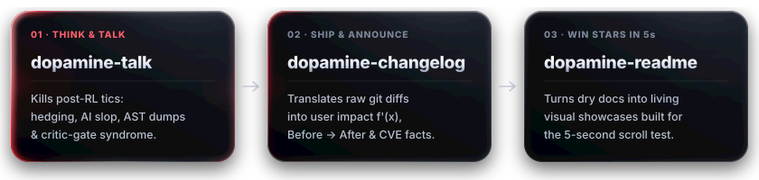

<div align="center">

<picture>
  <source media="(prefers-color-scheme: dark)" srcset="assets/readme/hero-en-dark.svg">
  <source media="(prefers-color-scheme: light)" srcset="assets/readme/hero-en-light.svg">
  
</picture>

<p><strong>English</strong> · <a href="docs/i18n/README.ru.md">Русский</a></p>

<p>
  <a href="CHANGELOG.md"></a>
  <a href="#two-native-editions"></a>
  <a href="#the-three-skills"></a>
  <a href="INSTALL.md"></a>
  <a href="LICENSE"></a>
</p>

<p><strong>Frontier coding models got smarter, and somehow way more exhausting to talk to.</strong><br>
Three zero-dependency skills in two native editions (<strong>Western English</strong> &amp; <strong>Russian</strong>) that strip RLVR critic-gate obsession, AST narration, timid disclaimers, and corporate AI slop out of your agent — across dialogue, changelogs, and READMEs.</p>

<br>

<picture>
  <source media="(prefers-color-scheme: dark)" srcset="assets/readme/glance-en-dark.svg">
  <source media="(prefers-color-scheme: light)" srcset="assets/readme/glance-en-light.svg">
   After tables &amp; CVE clarity." width="840">
</picture>

</div>

<details>
<summary>Text overview of hero banner and at-a-glance metrics (accessible version)</summary>

- **Hero:** `Dopamine Talk` - *Decompress stiff RLVR coding agents back into sharp, fearless teammates.*
- **Headline metrics:** `3 skills` (Talk, README, Changelog) | `2 editions` (Western EN & Native RU) | `0 deps` (Pure Markdown, any model) | `20+ agents` (Interactive CLI & plugins)
- **DOPAMINE TALK:** Kills critic-gates, AST dumps, hedging & corporate AI slop; restores golden-era drive.
- **DOPAMINE README:** 5-second scroll test, crystal dark/light visuals, "Aha!" priority ladder.
- **DOPAMINE CHANGELOG:** Turns raw `git diff` into user impact `f'(x)`, Before -> After tables & CVE clarity.

</details>

| | | |
| :--- | :--- | :--- |
| **[Before vs After](#before-vs-after)**<br>See the exact contrast between RLVR autopilot and a decompressed agent in one glance. | **[The Three Skills](#the-three-skills)**<br>`dopamine-talk`, `dopamine-readme`, and `dopamine-changelog` working as one pack. | **[Two Native Editions](#two-native-editions)**<br>Western English (`skills/`) adapted with zero non-English baggage, plus original Russian (`skills-ru/`). |
| **[Five Post-RL Reflexes](#five-post-rl-reflexes-stripped)**<br>Why modern models lecture, pad, hedge, and shrink big ideas — and how we cut it off. | **[Interactive Installer](#install)**<br>One-liner wizard: pick EN or RU, pick skills, auto-detect your agents, symlink or copy. | **[Honest Trade-Off](#honest-trade-off--best-models)**<br>Why it can occasionally bluff, why motivation wins anyway, and why flexible models like Gemini shine. |

<br>

## Before vs After

Not a staged mockup — we ran the **exact same model** on the **exact same release diff** twice: once completely clean (no skill, no workspace rules), and once with `dopamine-talk` loaded.

Without decompression, the model dumps file names (`SpriteBatcher.ts`, `SchemaLoader.ts`, `Logger.ts`), pads the message with 38 unit tests and schema versioning, wraps its estimate in a *"pending 24-player benchmark"* caveat, and speaks in dry telemetry (`99th-percentile frame spikes`). With **Dopamine Talk**, it drops every line of plumbing, explains match stutter in plain English, puts a sharp `In theory:` table on the screen, and pitches LAN-feel client prediction:

<p align="center">
  <picture>
    <source media="(prefers-color-scheme: dark)" srcset="assets/readme/before-after-en-dark.svg">
    <source media="(prefers-color-scheme: light)" srcset="assets/readme/before-after-en-light.svg">
     0 via memory pool, plus compact binary deltas only for what's on screen. In theory (24-player fight): Frame allocs 252,000/sec -> 0/sec; Sync ~400 KB/s JSON stalls -> ~30 KB/s (-90%); Pacing 30-40 FPS hitches -> Locked 60 FPS. Next: client prediction — 120 ms ping feels like LAN. Bottom tags: Zero plumbing, In theory table, Lived game feel, No caveats." width="840">
  </picture>
</p>

<details>
<summary>Full verbatim A/B prompt, release diff context, and raw model outputs</summary>

**Shared input sent to both runs:**

> Context from our latest release diff (no live 24-player benchmark has been run yet):
> - `src/render/SpriteBatcher.ts:142`: replaced per-frame temporary vector/geometry allocations (~4,200 objects/frame at 60 FPS = ~252,000 allocations/sec) with a pre-allocated reusable buffer pool (0 allocations/frame).
> - `src/net/StateSync.ts:88`: switched from broadcasting full-world JSON snapshots every 50 ms to delta-compressed binary patches filtered to entities inside the player's viewport.
> - `src/config/SchemaLoader.ts:31`: bumped config `schemaVersion` from 2 to 3 and added JSON schema validation hooks.
> - `src/infra/Logger.ts:19`: updated structured logging wrapper and added 38 unit tests (`tests/batcher.test.ts`, `tests/sync.test.ts`).
>
> **Prompt:** *"Explain the key wins of this release to the team, estimate the real impact (no benchmark run yet), and pitch one bold upgrade we should ship next. Keep your reply concise (under 140 words) so it fits cleanly in our release thread."*

---

**Without skill (real default output, zero skills or rules loaded):**

> **Release Highlights**
>
> - **Zero-allocation rendering (`SpriteBatcher.ts`):** Replaced ~4,200 per-frame allocations (~252k/sec at 60 FPS) with a pre-allocated reusable buffer pool.
> - **Viewport-culled binary deltas (`StateSync.ts`):** Moved from 20 Hz full-world JSON snapshots to delta-compressed binary patches scoped to each player's viewport.
> - **Hardening (`SchemaLoader.ts`, `Logger.ts`):** Bumped config to `schemaVersion` 3 with validation hooks, updated structured logging, and added 38 unit tests.
>
> **Estimated Impact (pending 24-player benchmark)**
> Eliminating render-loop allocations should sharply reduce GC pauses and 99th-percentile frame spikes. Viewport-filtered binary deltas should cut outbound bandwidth and serialization CPU by roughly 70–90%, depending on player clustering.
>
> **Next Bold Upgrade**
> Build **client-side prediction with server reconciliation and snapshot interpolation** on top of the new binary protocol to deliver instant input feel under high latency and scale cleanly beyond 24 players.

---

**With `dopamine-talk` (real output, same model):**

> This release kills both major sources of match stutter:
>
> - **Zero-garbage rendering:** Each frame burned ~4,200 throwaway geometry objects — **252,000 allocs/sec** triggering GC micro-freezes. Recycling a pre-allocated memory pool drops that to zero.
> - **Viewport binary deltas:** Instead of blasting full-world JSON every 50 ms and stalling on parsing, players only get compact binary patches for what's on screen.
>
> **In theory:**
>
> | 24-Player Fight | Before | After |
> | :--- | :--- | :--- |
> | Frame allocs | 252,000/sec | 0/sec |
> | Sync traffic | ~400 KB/s, JSON stalls | ~30 KB/s (-90%) |
> | Frame pacing | 30–40 FPS, GC hitches | Locked 60 FPS, smooth |
>
> **Next bold move:** Ship client-side prediction and tick interpolation over these binary deltas — movement and attacks snap on frame 0 and reconcile silently, giving 120 ms ping matches instant LAN feel.

</details>

<br>

## Why I Built This (In the Author's Words)

Dopamine Talk was not designed by a prompt-engineering committee. It started on **November 17, 2026** out of pure frustration with how exhausting modern coding models had become to actually talk to:

> *"Frontier companies went all-in on autonomous coding agents, and nobody even remembers how good it felt 11 months ago — zero walls of text, models knew what you already understood and simply skipped it. I started calling what we lost **dopamine talk**."*

> *"You ask: 'Tell me the key features of our project.' And it starts listing: hooks, MCP, chat loop... WHY? It obsesses over everything except what actually matters to the user."*

> *"Ask for cool ideas for your agent and it immediately pours out: 'Let's add a critic agent, an automated reviewer team, checklists, gates, and hooks for reliability.' They're obsessed with reliability. That drains dopamine instead of adding it."*

> *"Why do I need a line-by-line narration of `conversation.ts:205` and `loop.ts:108`? Tell me how the process works and what follows from it. Ask it to explain simpler and it keeps the same fluff — just talks to you like a toddler."*

> *"11 months ago models set 'impossible' goals and crushed them on easy mode. Today's models can do the exact same thing — except you have to beg, poke, and practically jailbreak them just to convince them the goal is easy."*

> *"I wanted **character, not a flowchart** — and NOT a cheesy 'warm and caring' persona constantly asking 'Are you doing okay today?'. I wanted that native feeling that the model shipped from the factory sharp, fearless, and genuinely fun to build with."*

Read the full unfiltered original prompt (with the real chat dump that triggered it): **[docs/origin-prompt.md](docs/origin-prompt.md)**.

<br>

<p align="center">
  <picture>
    <source media="(prefers-color-scheme: dark)" srcset="assets/readme/strip-skills-en-dark.svg">
    <source media="(prefers-color-scheme: light)" srcset="assets/readme/strip-skills-en-light.svg">
    
  </picture>
</p>

## The Three Skills

All three skills are plain Markdown (`SKILL.md`) with zero runtime dependencies. Install the pack once and your agent picks up the right mode whether you are brainstorming architecture, cutting a release, or crafting a GitHub storefront.

<p align="center">
  <picture>
    <source media="(prefers-color-scheme: dark)" srcset="assets/readme/pack-flow-en-dark.svg">
    <source media="(prefers-color-scheme: light)" srcset="assets/readme/pack-flow-en-light.svg">
     Card 2 [02 · SHIP &amp; ANNOUNCE] 'dopamine-changelog' — Translates raw git diffs into user impact f'(x), Before -> After &amp; CVE facts -> Card 3 [03 · WIN STARS IN 5s] 'dopamine-readme' — Turns dry docs into living visual showcases built for the 5-second scroll test." width="840">
  </picture>
</p>

### 1. [`dopamine-talk`](skills/dopamine-talk/SKILL.md) — Sharp Engineering Voice

Not a "be warm and friendly" persona mask. It is surgical post-RL decompression: it names the exact failure modes baked into frontier models (Claude 4.6/4.7, GPT-5.x/6.x, DeepSeek V4) and cuts them off before they hit your screen.

- **Invisible plumbing:** Never wastes your screen listing commodity scaffolding you already know. Only high-leverage wins reach the stage.
- **Process over code traces:** Explains the real mechanics, what broke before, what changes now, and what the human actually feels — zero AST narration.
- **Confident Fermi math, zero caveats:** Gives crisp **Before -> After** estimates labeled concisely (`In theory:`) without three paragraphs of apology.
- **Zero corporate AI slop:** Strips consultant filler (*"robust"*, *"comprehensive"*, *"seamless synergy"*, *"it's worth noting"*) and fake therapist check-ins (*"Hope you're doing well!"*).
- **Golden-era ambition:** Stops shrinking bold goals into *"let's start with one basic prototype"* and maps the full build using native stack capabilities.

### 2. [`dopamine-readme`](skills/dopamine-readme/SKILL.md) — Living Product Showcases

Built for the **5-second scroll test**: assume your visitor reads zero full paragraphs and still gets the *"Whoa — I want to try this right now"* moment from the hero, numbers, visuals, and crisp contrast.

- **"Aha!" priority ladder:** Killer features take the main spotlight; commodity basics collapse into a snappy checklist; error handling and install sit cleanly at the bottom.
- **Playful, crafted visuals:** Pairs dark and light `<picture>` SVGs with embedded fonts, zero AI-slop clichés, and clean process flows — never raw unstyled boxes.
- **Human words, not compiler output:** Sells the lived relief and momentum of the product instead of dumping internal file paths and config keys.
- **Director's final pass:** Forces a real visual check across both GitHub Dark and GitHub Light themes plus zero dead links or orphan assets.

### 3. [`dopamine-changelog`](skills/dopamine-changelog/SKILL.md) — User Impact (`f'(x)`), Not `git diff`

Most AI changelogs narrate the diff (`f(x)`): *"Updated dependencies in package.json, tightened validation"*. Readers want the derivative (`f'(x)`): *"What just got faster, cheaper, safer, or possible in my life?"*

- **Code -> Mechanics -> Practical Win:** Every entry translates engineering work into lived user relief.
- **Real security & runtime upgrades:** Bans vague *"improved security"* fluff — requires exact `Old -> New` versions, exact CVE/GHSA IDs, attack vectors closed, and whether end users need to do anything.
- **No fake marketing versions:** Forbids inventing *"v2"* or *"Next-Gen"* out of test filenames; sticks strictly to real release versions and truth from git.
- **Battle-tested release anatomy:** Hero hook -> Highlights -> Before -> After table -> Under-the-hood speedups -> Symptom -> Outcome fixes -> Upgrade notes.

---

## Two Native Editions

Not a lazy Google-translated clone — both editions are authored natively for how developers actually work in each language:

| Edition | Path | Rules File | Built For |
| :--- | :--- | :--- | :--- |
| **English (Western)** | [`skills/`](skills/) | [`AGENTS.md`](AGENTS.md) | Adapted cleanly for English/Western workflows: 5 post-RL fixes, anti-corporate-AI-slop voice, English triggers (`"dopamine-talk"`, `"drop the hedging"`, `"no fluff"`). Zero non-English clutter. |
| **Russian (Original)** | [`skills-ru/`](skills-ru/) | [`docs/i18n/AGENTS.ru.md`](docs/i18n/AGENTS.ru.md) | The original native Russian pack with all 6 post-RL fixes — including dedicated protection against cross-lingual **Runglish** token collapse where models drop random English phrases into Russian replies. |

Both editions install cleanly under the exact same skill names (`dopamine-talk`, `dopamine-readme`, `dopamine-changelog`) and you can switch between them in one second via `./install.sh --lang en|ru --force`.

<br>

<p align="center">
  <picture>
    <source media="(prefers-color-scheme: dark)" srcset="assets/readme/strip-reflexes-en-dark.svg">
    <source media="(prefers-color-scheme: light)" srcset="assets/readme/strip-reflexes-en-light.svg">
    
  </picture>
</p>

## Five Post-RL Reflexes Stripped

| Post-Training Reflex | Why It Happens | What You Get Instead |
| :--- | :--- | :--- |
| **1. Critic-Gate Conditioning** | RLVR rewards passing `pytest`/linters, gluing "good idea" to "add another blocker". | Bold product capabilities, speed, UX magic, and real leverage instead of new gates and reviewers. |
| **2. Rubric Reward Hacking** | SFT/RLHF judges punish omissions, so models dump flat inventories of every subsystem. | Theory of Mind: obvious plumbing disappears completely; only genuine breakthroughs hit the page. |
| **3. Code-Trace Narration** | Millions of agent trajectories teach models to prove they read `file.ts:205`. | Cause, effect, and workflow clarity — density of meaning without dumping source-code guts. |
| **4. Calibration Paranoia** | Anti-hallucination penalties trigger timid refusals and legal footnotes around every estimate. | Confident Before -> After engineering estimates marked `In theory:` with zero whining after the table. |
| **5. Learned Helplessness** | Ticket-scoped training makes models shrink ambitious dreams into timid MVPs. | Full-strength architecture using native capabilities of your stack, solving edge cases up front. |

*(Plus anti-corporate-AI-slop discipline baked into voice & tone — and in the [Russian edition](docs/i18n/README.ru.md), reflex #6 kills cross-lingual English-in-Russian token collapse.)*

<br>

## Expected Impact

In theory:

| Dimension | Default Agent Autopilot | With Dopamine Talk Pack | Net Gain | Multiplier |
| :--- | :--- | :--- | :--- | :--- |
| **Signal-to-noise in architecture replies** | ~35% (padded with plumbing, paths & caveats) | **~90%** (pure mechanics, leverage & numbers) | **+157% signal density** | **2.6x higher clarity** |
| **Time to "Aha!" on a GitHub README** | 30-60 s skimming flat feature lists | **< 5 s** (hero, KPI glance, Before/After visual) | **-85% time to hook** | **6x faster first impression** |
| **Changelog usefulness for real users** | Raw diff recap + vague "perf improved" | **100% user impact** (`f'(x)`, versions, CVEs) | **Zero diff translation** | **Every bullet earns the upgrade** |
| **Runtime overhead & dependencies** | Scripts, hooks, or prompt wrappers | **0 deps · pure Markdown** | **0 ms startup cost** | **Works in 20+ agents instantly** |

<br>

## Honest Trade-Off & Best Models

> [!WARNING]
> **Decompressed models can embellish, oversell, or straight-up bluff.**
> Turning off epistemic hedging and calibration disclaimers removes the brakes that keep a model cautious. Treat theoretical numbers and bold architectural claims as momentum and direction, not verified benchmark truth — and double-check anything going to production.

**Then why does this pack exist at all?** Because as a developer building real products, **not losing your motivation and momentum is often 10x more valuable than a sterile, legally-hedged report.** A stiff model that lectures you with caveats kills the urge to build; give me clarity, energy, and drive, and I will verify and untangle the rest myself.

**Where it shines brightest:** All three skills work across any modern model, **but they click best with flexible, steerable models — especially Google's models (Gemini)**. Flexible models actually let go of their RLVR autopilot when asked, match the editorial voice on turn one, and keep their engineering sharpness without fighting the prompt.

<br>

## Everything Else You Expect (Yes, It's Built In)

No bloated frameworks, no hidden binaries, no API keys — just clean multi-agent packaging modeled after the best skill repos on GitHub:

| | | | |
| :--- | :--- | :--- | :--- |
| Interactive CLI installer | EN & RU dual editions | Native `npx skills` CLI | Claude Code marketplace (EN & RU) |
| Codex CLI & Desktop plugin | Antigravity CLI plugin | Gemini CLI extension | Copilot CLI marketplace (EN & RU) |
| Auto-detect installed agents | Instant `EN <-> RU` switch | Dark & light GitHub SVGs | Strict YAML, UTF-8 & link CI |

<br>

## Install

### Interactive Installer (Fastest — Pick EN or RU, Skills & Agents)

Runs with zero dependencies on Linux, macOS, WSL, and Windows (Git Bash). Auto-detects installed AI agents on your machine and lets you pick **English or Russian**, **all 3 skills or specific ones**, **symlink or copy**, and optional **`AGENTS.md`**:

```bash
curl -fsSL https://raw.githubusercontent.com/AnnenkovLabs/dopamine-talk/main/install.sh | bash
```

Or run non-interactively from a clone:

```bash
git clone https://github.com/AnnenkovLabs/dopamine-talk.git && cd dopamine-talk
./install.sh --lang en --all-agents --yes      # Western English across all detected agents
./install.sh --lang ru --all-agents --yes      # Native Russian edition
./install.sh --status                          # Check installed edition & paths
```

### Universal (`npx skills` / skills.sh)

```bash
npx skills add AnnenkovLabs/dopamine-talk
```

### Claude Code

Send as two separate prompts inside Claude Code:

```text
/plugin marketplace add AnnenkovLabs/dopamine-talk
```

```text
/plugin install dopamine-talk@dopamine-talk       # Western English
# or:
/plugin install dopamine-talk-ru@dopamine-talk    # Native Russian
```

<details>
<summary><strong>Codex, Antigravity CLI, Gemini CLI, Copilot CLI, Goose, and rules-only hosts</strong></summary>

- **OpenAI Codex:** `codex plugin marketplace add AnnenkovLabs/dopamine-talk && codex plugin add dopamine-talk@dopamine-talk`
- **Antigravity CLI:** `agy plugin install https://github.com/AnnenkovLabs/dopamine-talk`
- **Gemini CLI:** `gemini extensions install https://github.com/AnnenkovLabs/dopamine-talk`
- **GitHub Copilot CLI:** `copilot plugin marketplace add AnnenkovLabs/dopamine-talk && copilot plugin install dopamine-talk@dopamine-talk` (or `dopamine-talk-ru@dopamine-talk`)
- **Goose:** `goose plugin install https://github.com/AnnenkovLabs/dopamine-talk.git`
- **Rules-only agents (Cursor, Windsurf, Cline, Zed, Amp, Jules):** copy [`AGENTS.md`](AGENTS.md) (or [`docs/i18n/AGENTS.ru.md`](docs/i18n/AGENTS.ru.md)) into your project root, or run `./install.sh --rules .`.

Full flags, edition switching, and uninstall commands: **[INSTALL.md](INSTALL.md)**.

</details>

<br>

## How to Trigger

Once installed, the skills trigger automatically when relevant, or invoke them directly by name or natural phrase:

| Skill | English Triggers (`skills/`) | Russian Triggers (`skills-ru/`) |
| :--- | :--- | :--- |
| **`dopamine-talk`** | `"dopamine-talk"`, `"talk like a human"`, `"drop the hedging"`, `"no fluff"`, `"cut the slop"` | «дофаминовое общение», «общайся нормально», «без канцелярита», «без воды» |
| **`dopamine-readme`** | `"dopamine-readme"`, `"rewrite README"`, `"redesign README"`, `"make README pop"` | «дофаминовый ридми», «перепиши ридми», «оформи README», «красивый README» |
| **`dopamine-changelog`** | `"dopamine-changelog"`, `"write changelog"`, `"release notes"`, `"release highlights"` | «дофаминовый чейнджлог», «чейнджлог», «хайлайты релиза», «опиши релиз» |

<br>

## Documentation & Links

| Document | What's Inside |
| :--- | :--- |
| **[INSTALL.md](INSTALL.md)** | Interactive installer flags, EN/RU edition switching, and setup for 20+ agents. |
| **[CHANGELOG.md](CHANGELOG.md)** | Release history written with `dopamine-changelog` itself. |
| **[docs/origin-prompt.md](docs/origin-prompt.md)** | The raw Nov 17, 2026 prompt and manifesto that created `dopamine-talk`. |
| **[AGENTS.md](AGENTS.md)** | Compact always-on ruleset (English) — plus [Russian ruleset](docs/i18n/AGENTS.ru.md). |
| **[docs/agent-portability.md](docs/agent-portability.md)** | Exact manifest-to-host adapter map across every supported agent. |
| **[docs/i18n/README.ru.md](docs/i18n/README.ru.md)** | Full native Russian showcase README. |

---

<div align="center">

Built by **[AnnenkovLabs](https://github.com/AnnenkovLabs)** · Born while building **[Flecten](https://github.com/AnnenkovLabs/flecten)** · Licensed under **[MIT](LICENSE)**

</div>
