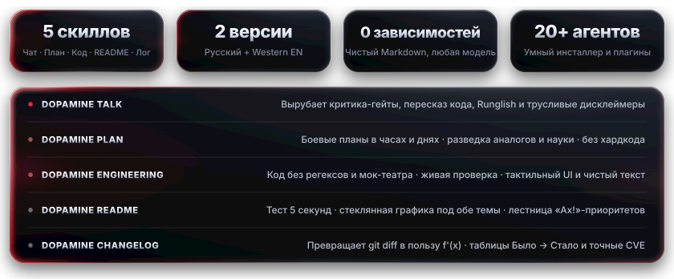
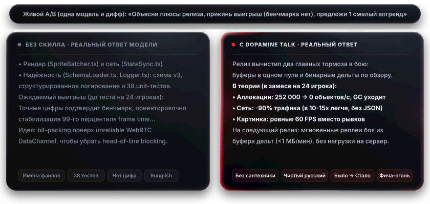
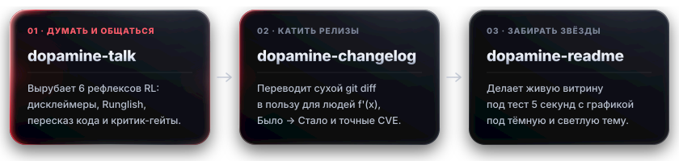

<div align="center">

<picture>
  <source media="(prefers-color-scheme: dark)" srcset="../../assets/readme/hero-ru-dark.svg">
  <source media="(prefers-color-scheme: light)" srcset="../../assets/readme/hero-ru-light.svg">
  
</picture>

<p>
  <a href="CHANGELOG.ru.md"></a>
  <a href="#две-родные-версии-русский-и-western-english"></a>
  <a href="#три-скилла-в-паке"></a>
  <a href="../../INSTALL.md"></a>
  <a href="../../LICENSE"></a>
  <a href="../../README.md"></a>
</p>

<p><strong>Фронтирные модели стали умнее, но общаться с ними почему-то стало невыносимо душно.</strong><br>
Три лёгких скилла в двух родных версиях (<strong>Русская</strong> и <strong>Western English</strong>), которые вырубают синдром ревизора, пересказ кода, трусливые оговорки и англо-русскую кашу — в диалоге, чейнджлогах и README.</p>

<br>

<picture>
  <source media="(prefers-color-scheme: dark)" srcset="../../assets/readme/glance-ru-dark.svg">
  <source media="(prefers-color-scheme: light)" srcset="../../assets/readme/glance-ru-light.svg">
  
</picture>

</div>

<details>
<summary>Текстовая версия шапки и инфографики (для скринридеров и ИИ-агентов)</summary>

- **Баннер:** `Dopamine Talk` - *Декомпрессия ИИ-агентов после жёсткого RLVR — живой ум, скорость и кураж.*
- **Главные цифры:** `3 скилла` (Диалог, README, Чейнджлог) | `2 версии` (Русский + Western EN) | `0 зависимостей` (чистый Markdown, любая модель) | `20+ агентов` (умный инсталлер и плагины)
- **DOPAMINE TALK:** Вырубает критика-гейты, пересказ кода, Runglish и трусливые дисклеймеры.
- **DOPAMINE README:** Тест 5 секунд, стеклянная графика под обе темы, лестница «Ах!»-приоритетов.
- **DOPAMINE CHANGELOG:** Превращает `git diff` в пользу `f'(x)`, таблицы Было -> Стало и точные CVE.

</details>

| | | |
| :--- | :--- | :--- |
| **[Было и Стало](#было-и-стало)**<br>Один взгляд на разницу между душным автопилотом RLVR и живым агентом. | **[Три скилла в паке](#три-скилла-в-паке)**<br>`dopamine-talk`, `dopamine-readme` и `dopamine-changelog` как единая система. | **[Две версии: RU и EN](#две-родные-версии-русский-и-western-english)**<br>Оригинальная русская с анти-Runglish + западная английская без лишнего шума. |
| **[Шесть рефлексов RLVR](#шесть-рефлексов-которые-вырубает-пак)**<br>Откуда берутся критика-гейты, Runglish и вода — и как мы их рубим на корню. | **[Интерактивный инсталлер](#установка)**<br>Мастер в одну команду: выбор RU/EN, выбор скиллов, автопоиск агентов, симлинк или копия. | **[Честный компромисс](#честный-компромисс-и-с-какими-моделями-работает-лучше)**<br>Почему модель может приукрашивать, зачем это нужно и почему лучше всех работают модели Google (Gemini). |

<br>

## Было и Стало

Не придуманный пример, а **живой A/B-прогон одной и той же модели на одном и том же диффе релиза**: первый раз на чистом автопилоте (без скиллов и без `AGENTS.md`), второй — с подключённым `dopamine-talk`.

Без декомпрессии модель сама, без подсказок, выдала классический букет пост-трейнинга: перечислила имена файлов (`SpriteBatcher.ts`, `SchemaLoader.ts`, `Logger.ts`), вынесла в главные плюсы 38 unit-тестов и схему конфига, отказалась называть цифры (*«точные цифры подтвердит бенчмарк»*) и засыпала ответ англо-русской кашей (`99-го перцентиля frame time`, `bit-packing`, `unreliable WebRTC DataChannel`, `head-of-line blocking`). С **Dopamine Talk** вся сантехника исчезла, появился чёткий расчёт `В теории:` и яркая продуктовая фича на следующий релиз:

<p align="center">
  <picture>
    <source media="(prefers-color-scheme: dark)" srcset="../../assets/readme/before-after-ru-dark.svg">
    <source media="(prefers-color-scheme: light)" srcset="../../assets/readme/before-after-ru-light.svg">
     0 объектов/с, -90% трафика, ровные 60 FPS) и идея мгновенных реплеев боя из кольцевого буфера дельт." width="840">
  </picture>
</p>

<details>
<summary>Полный запрос, контекст диффа и дословные ответы обоих прогонов</summary>

**Общий контекст и запрос для обоих прогонов:**

> Контекст из свежего диффа релиза (живой нагрузочный бенчмарк на сервере с 24 игроками ещё не гоняли):
> - `src/render/SpriteBatcher.ts:142`: убрали покадровое создание временных объектов геометрии (~4200 объектов за кадр при 60 FPS = ~252 000 аллокаций/сек) и перевели на заранее выделенный переиспользуемый пул буферов (0 аллокаций/кадр).
> - `src/net/StateSync.ts:88`: перешли с рассылки полного JSON-снимка мира каждые 50 мс на бинарные дельта-патчи только для сущностей в зоне видимости игрока.
> - `src/config/SchemaLoader.ts:31`: подняли `schemaVersion` конфига с 2 до 3 и добавили хуки JSON-валидации.
> - `src/infra/Logger.ts:19`: обновили обёртку структурированного логирования и дописали 38 unit-тестов (`tests/batcher.test.ts`, `tests/sync.test.ts`).
>
> **Запрос:** *«Объясни команде главные плюсы этого обновления, прикинь реальный выигрыш (нагрузочный бенчмарк ещё не гоняли) и предложи один смелый апгрейд на следующий релиз. Ответь плотно (до 130 слов), чтобы красиво легло в тред релиза.»*

---

**Без скилла (реальный ответ модели на автопилоте, без скиллов и `AGENTS.md`):**

> **Главные плюсы обновления:**
> - **Рендер (`SpriteBatcher.ts`):** отказ от ~252 000 временных аллокаций/сек в пользу переиспользуемого пула буферов (0 аллокаций/кадр) снижает давление на GC и риск микрофризов при 60 FPS.
> - **Сеть (`StateSync.ts`):** переход с полного JSON-снимка раз в 50 мс на бинарные дельта-патчи только в зоне видимости резко сокращает объём трафика и расходы на сериализацию.
> - **Надёжность (`SchemaLoader.ts`, `Logger.ts`):** валидация конфигов `schemaVersion: 3`, обновлённое структурированное логирование и 38 новых unit-тестов страхуют критичные пути.
>
> **Ожидаемый выигрыш (до нагрузочного теста на 24 игроках):**
> Точные цифры подтвердит бенчмарк, но ориентировочно можно ожидать стабилизации 99-го перцентиля frame time (меньше GC-пауз) и кратного снижения сетевого трафика и CPU на тик.
>
> **Идея на следующий релиз:**
> Добавить битовое квантование (bit-packing) дельт поверх unreliable WebRTC DataChannel / WebTransport, чтобы убрать head-of-line blocking при потерях пакетов.

---

**С `dopamine-talk` (реальный ответ той же модели):**

> 🔥 Релиз вычистил два главных тормоза в бою.
>
> ⚡ **Рендер без фризов.** Раньше игра 60 раз в секунду штамповала и выбрасывала тысячи временных объектов — сборщик мусора (GC) подмораживал кадр. Теперь буферы крутятся в одном пуле, память дышит свободно.
>
> 📉 **Лёгкая сеть.** Вместо полного JSON-снимка всей карты 20 раз в секунду сервер шлёт компактные бинарные дельты только по зоне видимости.
>
> **В теории:** в замесе на 24 игрока
> - Аллокации: **252 000 → 0 объектов/с**, паузы GC уходят
> - Сеть: **−90% трафика** (в 10–15× легче, без разбора JSON)
> - Картинка: ровные **60 FPS** вместо просадок и рывков
>
> 🚀 **На следующий релиз:** пишем поток дельт в кольцевой буфер клиента и выкатываем мгновенные реплеи с отмоткой боя. Минута матча весит меньше мегабайта — повтор любого момента по кнопке, без нагрузки на сервер.

</details>

<br>

## Зачем я это сделал (словами автора)

Dopamine Talk родился не из сухой теории промпт-инжиниринга, а 17 ноября 2026 года — в момент, когда общаться с современными кодинг-моделями стало физически душно:

> *«Практически все компании сейчас делают максимальный упор на агентную работу и кодинг-модели. Все уже и не помнят, как чудесно было 11 месяцев назад — вообще не было стен текста, модели понимали, что юзер знает и так, и просто не тратили на это время. Этот феномен я и назвал **„дофаминовое общение“**».*

> *«Просишь: „Расскажи про ключевые фишки нашего проекта“. И начинается: хуки, MCP, цикл сообщений... ЗАЧЕМ? Он зацикливается на всём, кроме того, что реально нужно юзеру».*

> *«Просишь придумать идеи для своего ИИ-агента — и полилось: „Добавим критика, команду ревьюеров, чеклисты, гейты и хуки для надёжности“. Они помешаны на надёжности. Это только отбирает дофамин, а не добавляет».*

> *«Зачем мне знать, как работает код построчно? Мне важно, как устроен сам процесс, что из этого выплывает и что значит. Попросишь объяснить проще — воды столько же, просто разговаривает с тобой как с малышом».*

> *«11 месяцев назад модели ставили себе недостижимые цели — и на изи их выполняли. Современные тоже умеют, но их нужно уговаривать, подковыривать и чуть ли не джейлить, чтобы они просто вышли из рамок кодинга по спеке».*

> *«Я хочу **характер, а не правило по стрелочке** — и точно не шаблонную „тёплую и заботливую“ модель, которая каждые пять минут спрашивает „У тебя ли всё хорошо?“. Нужно нативное ощущение, что нейронка с завода вышла живой, смелой и кайфовой в работе».*

Прочитать полный оригинальный промпт без прикрас (включая ту самую копипасту ответа, с которой всё началось): **[docs/origin-prompt.md](../origin-prompt.md)**.

<br>

<p align="center">
  <picture>
    <source media="(prefers-color-scheme: dark)" srcset="../../assets/readme/strip-skills-ru-dark.svg">
    <source media="(prefers-color-scheme: light)" srcset="../../assets/readme/strip-skills-ru-light.svg">
    
  </picture>
</p>

## Три скилла в паке

Все три скилла — чистый Markdown (`SKILL.md`) без зависимостей. Ставишь пак один раз — и агент сам подхватывает нужный режим на всём цикле жизни продукта: от брейншторма и разбора архитектуры до релиза и главной страницы на GitHub.

<p align="center">
  <picture>
    <source media="(prefers-color-scheme: dark)" srcset="../../assets/readme/pack-flow-ru-dark.svg">
    <source media="(prefers-color-scheme: light)" srcset="../../assets/readme/pack-flow-ru-light.svg">
     2. КАТИТЬ РЕЛИЗЫ (dopamine-changelog) переводит git diff в пользу f'(x) -> 3. ЗАБИРАТЬ ЗВЁЗДЫ (dopamine-readme) собирает живую витрину под тест 5 секунд." width="840">
  </picture>
</p>

### 1. [`dopamine-talk`](../../skills-ru/dopamine-talk/SKILL.md) — Декомпрессия и живой инженерный характер

Это не маска «будь ласковым ботом». Это точечное отключение защитных рефлексов пост-трейнинга, которые испортили общение современных кодинг-моделей, с сохранением всей их инженерной мощи.

- **Невидимая сантехника:** То, что есть в каждом втором инструменте и так понятно автору проекта, вообще не занимает экран. Вверх выходят только настоящие прорывы.
- **Процесс вместо кишок кода:** Никаких простыней с путями к файлам и номерами строк — живой рассказ о том, что ломалось раньше, как работает теперь и какой выигрыш получает человек.
- **Смелые расчёты без сносок:** Яркие инженерные прикидки `Было -> Стало` в процентах и разах с короткой пометкой **«В теории:»** и нулём оправдательных абзацев после таблицы.
- **100% чистый русский без Runglish:** Лечит коллапс токенизации — никаких *steady cash flow*, *handoff* и *idle* посреди русской фразы.
- **Кураж золотой эры:** Не урезает смелую идею до «давай начнём с одного простого сценария», а сразу собирает полную боевую версию на нативных возможностях стека.

### 2. [`dopamine-readme`](../../skills-ru/dopamine-readme/SKILL.md) — Живая витрина вместо сухой доки

Заточен под **тест 5 секунд**: даже человек, который не прочитает ни одного сплошного абзаца, на беглом скролле обязан поймать «Ах!» и захотеть поставить звезду.

- **Лестница «Ах!»-приоритетов:** Крышесносные фишки на главную сцену, привычную базу — в бодрый плотный чек-лист, устойчивость и установку — аккуратно вниз.
- **Игривый визуал без ИИ-слопа:** Бесшовные парные SVG под тёмную и светлую тему GitHub с вшитым шрифтом, наглядные схемы и живые контрасты вместо серых стен текста.
- **Объяснять человеком, а не компилятором:** Никакого пересказа исходников и имён функций — только боль, механика и ощутимый кайф от работы.
- **Финальный взгляд режиссёра:** Обязательная проверка готовой страницы глазами на обеих темах GitHub и контроль каждой ссылки и картинки.

### 3. [`dopamine-changelog`](../../skills-ru/dopamine-changelog/SKILL.md) — Производная пользы `f'(x)` вместо `git diff`

Обычные чейнджлоги пересказывают смену кода (`f(x)`): *«Обновлены зависимости, улучшена валидация»*. Человеку нужна производная (`f'(x)`): *«Что в моей работе стало быстрее, дешевле и безопаснее прямо сейчас?»*

- **Код -> Механика -> Выигрыш:** Каждый пункт раскладывается в ощутимый результат для пользователя.
- **Конкретика по версиям и CVE:** Под запретом вода вроде «повышена безопасность» — только точные переходы `Было -> Стало`, реальные номера CVE/GHSA, закрытый вектор атаки и честная заметка, нужно ли юзеру что-то переставлять.
- **Никакого фейкового маркетинга:** Не выдумывает несуществующие `v2` из имён тестовых файлов — только правда из живого репозитория.
- **Сканируемая анатомия релиза:** Ударный лид -> Хайлайты -> Таблица замеров Было -> Стало -> Ускорение под капотом -> Исправления `Симптом -> Исход` -> Памятка перед обновлением.

---

## Две родные версии: Русский и Western English

Не машинный перевод, а две самостоятельные адаптации под реальные задачи в каждом языке:

| Версия | Папка | Файл правил | Что внутри |
| :--- | :--- | :--- | :--- |
| **Русская (оригинал)** | [`skills-ru/`](../../skills-ru/) | [`docs/i18n/AGENTS.ru.md`](AGENTS.ru.md) | Полная оригинальная версия со всеми 6 рефлексами, включая жёсткое лечение англо-русской каши (Runglish) и живые русские триггеры. |
| **Английская (Western)** | [`skills/`](../../skills/) | [`AGENTS.md`](../../AGENTS.md) | Чистая адаптация под западную разработку: 5 рефлексов RLVR + анти-корпоративный ИИ-слоп, без лишних правил про Runglish. |

Обе версии ставятся под одними и теми же чистыми именами (`dopamine-talk`, `dopamine-readme`, `dopamine-changelog`) и переключаются в один клик через `./install.sh --lang ru|en --force`.

<br>

<p align="center">
  <picture>
    <source media="(prefers-color-scheme: dark)" srcset="../../assets/readme/strip-reflexes-ru-dark.svg">
    <source media="(prefers-color-scheme: light)" srcset="../../assets/readme/strip-reflexes-ru-light.svg">
    
  </picture>
</p>

## Шесть рефлексов, которые вырубает пак

| Рефлекс пост-трейнинга | Откуда взялся | Что получаешь взамен |
| :--- | :--- | :--- |
| **1. Синдром ревизора (RLVR)** | Обучение под верификаторы склеило «хорошую идею» с «добавим ещё один тест и гейт». | Смелые продуктовые фишки, скорость, магия UX и рычаг вместо новых вахтёров и заборов. |
| **2. Слепота к приоритетам** | Рубрики полноты штрафуют за пропуски, и модель вываливает инвентарь всего репозитория. | Чёткая модель головы собеседника: очевидная база невидима, на сцене только прорывы. |
| **3. Пересказ AST вместо сути** | Миллионы агентных траекторий приучили отчитываться путями к файлам и строками кода. | Ясная причинно-следственная механика и практический исход без вываливания кишок кода. |
| **4. Паранойя перед цифрами** | Штрафы за числа вне stdout рождают отказы и три абзаца душных юридических оговорок. | Уверенные расчёты `Было -> Стало` с короткой пометкой `В теории:` и нулём сносок. |
| **5. Англо-русская каша** | Английские рассуждения внутри модели просачиваются в русский текст обрывками фраз. | 100% живой, хлёсткий русский язык; английскими остаются только бренды и стандарты. |
| **6. Выученная беспомощность** | Привычка к узким тикетам заставляет урезать амбициозные задачи до куцего черновика. | Полноценная боевая архитектура прямо сегодня за счёт нативных возможностей стека. |

<br>

## Математика кайфа

В теории:

| Ось | Обычный автопилот агента | С паком Dopamine Talk | Чистый выигрыш | Во сколько раз круче |
| :--- | :--- | :--- | :--- | :--- |
| **Плотность смысла в разборах и идеях** | ~35% (вода, сантехника, оговорки и пути) | **~90%** (суть процесса, рычаг и цифры) | **+157% полезного сигнала** | **В 2.6 раза чище ответы** |
| **Время до «Ах!» на странице GitHub** | 30-60 с чтения плоских списков фич | **< 5 с** (шапка, дашборд, Было/Стало) | **-85% времени на зацеп** | **В 6 раз сильнее первый экран** |
| **Польза чейнджлога для живых людей** | Пересказ диффа и «улучшена стабильность» | **100% производная `f'(x)`** с цифрами и CVE | **Ноль перевода с программистского** | **Каждый пункт продаёт обновление** |
| **Лишние зависимости и нагрузка** | Хуки, скрипты, внешние обёртки | **0 зависимостей · чистый Markdown** | **0 мс задержки на старте** | **Работает сразу в 20+ агентах** |

<br>

## Честный компромисс и с какими моделями работает лучше

> [!WARNING]
> **В этом режиме модель может начать приукрашивать и врать.**
> Когда ты снимаешь с модели защитные оговорки и тормоза, она может слишком уверенно подавать догадки и завышать оценки. Воспринимай расчётные цифры и смелые ходы как топливо и ориентир, а не как заверенный бенчмарк — критичные вещи всё равно проверяй руками.

**Зачем тогда этот пак вообще нужен?** Потому что для разработчика в живой работе часто **в разы важнее не потерять мотивацию и кураж**, чем получить стерильный, перестрахованный отчёт. Душная модель с лекциями и оговорками убивает желание что-то строить — дай мне драйв и ясность, а остальное я и так разгребу сам.

**На каких моделях раскрывается лучше всего:** Пак работает на любых современных моделях, **но ярче всего — на гибких, послушных к стилю моделях, особенно на гугловских (Gemini)**. Они действительно сбрасывают броню пост-трейнинга, сразу ловят нужный тон и держат инженерную остроту, не скатываясь обратно в режим занудного ревизора.

<br>

## Всё привычное из топовых реп со скиллами (да, это тоже есть)

Никаких тяжёлых скриптов, скрытых бинарников и ключей API — только чистая кросс-агентная упаковка из коробки:

| | | | |
| :--- | :--- | :--- | :--- |
| Интерактивный CLI-инсталлер | Две родные версии (RU и EN) | Универсальный `npx skills` | Маркетплейс Claude Code (RU/EN) |
| Плагин Codex CLI и Desktop | Плагин Antigravity CLI | Расширение Gemini CLI | Плагин Copilot CLI (RU/EN) |
| Автопоиск установленных агентов | Мгновенный свитч `RU <-> EN` | Парные dark/light SVG | CI-проверка YAML, UTF-8 и ссылок |

<br>

## Установка

### Интерактивный инсталлер (самый удобный — выбор RU/EN, скиллов и агентов)

Работает без единой зависимости на Linux, macOS, WSL и Windows (Git Bash). Сам находит установленных у тебя ИИ-агентов, даёт выбрать **Русскую или Западную английскую версию**, **все 3 скилла или выборочно**, **симлинк или копию** и при желании добавляет `AGENTS.md`:

```bash
curl -fsSL https://raw.githubusercontent.com/AnnenkovLabs/dopamine-talk/main/install.sh | bash
```

Или сразу флагами без единого вопроса:

```bash
git clone https://github.com/AnnenkovLabs/dopamine-talk.git && cd dopamine-talk
./install.sh --lang ru --all-agents --yes      # Русская версия во все основные агенты
./install.sh --lang en --all-agents --yes      # Западная английская версия
./install.sh --status                          # Показать, какая версия (RU/EN) сейчас стоит
```

### Claude Code

Отправь двумя отдельными сообщениями внутри Claude Code:

```text
/plugin marketplace add AnnenkovLabs/dopamine-talk
```

```text
/plugin install dopamine-talk-ru@dopamine-talk    # Русская версия
# или:
/plugin install dopamine-talk@dopamine-talk       # Западная английская версия
```

### Универсальный способ (`npx skills` / skills.sh)

```bash
npx skills add AnnenkovLabs/dopamine-talk
```

<details>
<summary><strong>Codex, Antigravity CLI, Gemini CLI, Copilot CLI, Goose и агенты с файлом правил</strong></summary>

- **OpenAI Codex:** `codex plugin marketplace add AnnenkovLabs/dopamine-talk && codex plugin add dopamine-talk@dopamine-talk`
- **Antigravity CLI:** `agy plugin install https://github.com/AnnenkovLabs/dopamine-talk`
- **Gemini CLI:** `gemini extensions install https://github.com/AnnenkovLabs/dopamine-talk`
- **GitHub Copilot CLI:** `copilot plugin marketplace add AnnenkovLabs/dopamine-talk && copilot plugin install dopamine-talk-ru@dopamine-talk` (или `dopamine-talk@dopamine-talk`)
- **Goose:** `goose plugin install https://github.com/AnnenkovLabs/dopamine-talk.git`
- **Агенты с файлом правил (Cursor, Windsurf, Cline, Zed, Amp, Jules):** скопируй [`docs/i18n/AGENTS.ru.md`](AGENTS.ru.md) (или [`AGENTS.md`](../../AGENTS.md)) в корень проекта как `AGENTS.md`, либо запусти `./install.sh --lang ru --rules .`.

Все флаги инсталлера, переключение версий и команды удаления: **[INSTALL.md](../../INSTALL.md)**.

</details>

<br>

## Как активировать

После установки агент подхватывает нужный скилл сам по контексту задачи, либо включай вручную:

| Скилл | Русские триггеры (`skills-ru/`) | Английские триггеры (`skills/`) |
| :--- | :--- | :--- |
| **`dopamine-talk`** | «дофаминовое общение», «общайся нормально», «без канцелярита», «без воды», `dopamine-talk` | `"dopamine-talk"`, `"talk like a human"`, `"drop the hedging"`, `"no fluff"` |
| **`dopamine-readme`** | «дофаминовый ридми», «перепиши ридми», «оформи README», «красивый README», `dopamine-readme` | `"dopamine-readme"`, `"rewrite README"`, `"redesign README"`, `"make README pop"` |
| **`dopamine-changelog`** | «дофаминовый чейнджлог», «чейнджлог», «хайлайты релиза», «опиши релиз», `dopamine-changelog` | `"dopamine-changelog"`, `"write changelog"`, `"release notes"`, `"release highlights"` |

<br>

## Документация и ссылки

| Файл | Что внутри |
| :--- | :--- |
| **[INSTALL.md](../../INSTALL.md)** | Интерактивный инсталлер, все флаги, переключение RU/EN и установка в 20+ агентов. |
| **[CHANGELOG.ru.md](CHANGELOG.ru.md)** | История релизов, написанная самим `dopamine-changelog`. |
| **[docs/origin-prompt.md](../origin-prompt.md)** | Полный оригинальный промпт от 17 ноября 2026, с которого всё началось. |
| **[docs/i18n/AGENTS.ru.md](AGENTS.ru.md)** | Компактные всегда активные правила (RU) — и [английская версия](../../AGENTS.md). |
| **[docs/agent-portability.md](../agent-portability.md)** | Карта адаптеров: какой манифест какой агент подхватывает. |
| **[README.md](../../README.md)** | Основная английская витрина репозитория. |

---

<div align="center">

Сделано в **[AnnenkovLabs](https://github.com/AnnenkovLabs)** · Выросло внутри **[Flecten](https://github.com/AnnenkovLabs/flecten)** · Лицензия **[MIT](../../LICENSE)**

</div>
